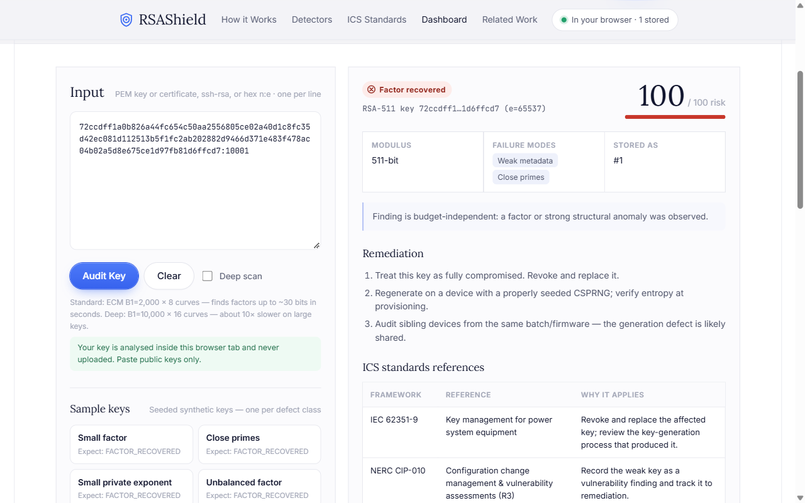

<div align="center">

# RSAShield

**Find RSA keys that were generated badly, before someone else does.**

An offline, multi-signal auditor for RSA *public* keys, built for security reviews of
long-lived industrial and substation equipment.

[**Live demo**](https://rsashield.vercel.app) ·
[Dashboard](https://rsashield.vercel.app/dashboard.html) ·
[Results](docs/RESULTS.md) ·
[Research plan](docs/RESEARCH_PLAN.md) ·
[Threat model](docs/THREAT_MODEL.md)


</div>

---

## Why this exists

Embedded devices often generate their RSA keys at first boot, before the system has
gathered enough randomness. The keys look normal but are not: some share a prime with
another device, some have two primes almost equal, and some have a factor far smaller than
it should be. Anyone who notices can recover the private key from the public one.

Substations and other industrial sites keep the same equipment, and the same keys, for
decades. RSAShield lets an operator paste in a fleet's public keys and get a prioritised
list of the ones that need replacing, mapped to the standards those teams already work to
(IEC 62351, NERC CIP, NIST SP 800-57).

## What it catches

No single algorithm catches every key-generation failure, so RSAShield runs six
complementary detectors and fuses their findings into one risk score.

| Detector | What it finds | Failure it points to |
|---|---|---|
| **Batch GCD** | a prime shared between any two keys in the set (product/remainder trees) | low entropy across a batch of devices |
| **Fermat** | primes drawn too close together | a broken prime search |
| **Trial division** | a tiny prime factor | a truncated or faulty generator |
| **Bounded ECM** | a small/unbalanced factor beyond trial division | an unbalanced key |
| **Wiener** | a private exponent `d` chosen too small | a speed "optimisation" |
| **Metadata** | undersized modulus, invalid, even or non-standard exponent, skewed byte statistics | policy advisory |

Each finding comes with a classification, a 0–100 risk score, the failure mode,
remediation steps and the relevant ICS standards references.



## Results

Measured on a seeded, labelled corpus with known ground truth
([full write-up](docs/RESULTS.md)):

| Metric | Value |
|---|---|
| Precision / Recall / F1 | **1.000 / 1.000 / 1.000** |
| False-positive rate | 0.000 (15 TP · 0 FP · 0 FN · 6 TN) |
| Risk-score separation | healthy ≤ 10, defective ≥ 100 |
| "Secure" labels emitted | 0, by design |
| ECM speed-up (Montgomery ladder vs affine Weierstrass) | ~43× (359 s → 8 s) |

The ECM marginal-yield study (RQ2) charts detection rate against factor size and
`(B1, curves)` budget. It shows where ECM stops paying off, which is why shared and close
primes are left to batch GCD and Fermat.

## Design decisions worth knowing

- **ECM is a bounded detector, not a weak-key oracle.** Its cost depends on the smallest
  factor, so it cannot split a balanced modulus from a weak RNG. It runs under a strict
  budget, and a failed run proves nothing. Entropy failures are mostly caught by batch GCD
  and Fermat. This correction is central to the project.
- **There is no "secure" verdict.** The best possible result is `NO_DEFECT_FOUND`: no
  detector fired within its budget. That is never presented as proof of security.
- **Recovered factors never leave the forensic layer.** Operator reports, the CLI output
  and every API response carry findings, never private key material.
- **Your key never leaves your machine.** The hosted site runs the same Rust engine,
  compiled to WebAssembly, inside a Web Worker. Nothing is uploaded.
- **Private keys are refused.** Anything that looks like a private key is rejected before
  it is parsed or stored.

## Try it

**In the browser:** open the [live demo](https://rsashield.vercel.app/dashboard.html),
pick a sample key (one per defect class) or paste your own.

**From the command line:**

```sh
cargo build --release

# audit one key: PEM/DER file, certificate, ssh-rsa line, or - for stdin
cargo run --release -- audit path/to/key.pem

# audit a hex modulus:exponent pair
cargo run --release -- audit --hex "<modulus_hex>:10001"

# audit a whole fleet together (enables shared-prime batch GCD)
cargo run --release -- audit-corpus keys.txt

# reproduce the labelled benchmark and the ECM study
cargo run --release -- bench --seed 1 --bits 512 --out bench-out
cargo run --release -- study-ecm --seed 1 --bits 512

# run the web UI locally
cargo run --release -- serve            # http://127.0.0.1:8080
```

A full walkthrough runs with `scripts/demo.sh` (or `scripts/demo.ps1` on Windows).

**Accepted input:** PEM public keys (PKCS#1 or SPKI), X.509 certificates, OpenSSH
`ssh-rsa` lines and hex `modulus:exponent` pairs, one key or a mixed list. EC and Ed25519
keys are recognised and rejected with a clear message.

## How it fits together

```
                ┌──────────────── src/ (one Rust core) ────────────────┐
                │ key parsing · 6 detectors · scoring · ICS standards  │
                │ benchmark generator + evaluator · operator reports   │
                └──────┬───────────────────┬────────────────────┬──────┘
                       │                   │                    │
                 rsashield CLI      rsashield serve      wasm32 build (src/wasm.rs)
                 audit / bench      std-only HTTP +      Web Worker in the browser
                 study-ecm          JSON API             → rsashield.vercel.app
```

The web UI in [`web/`](web/) is plain HTML, CSS and JS with no build step. The local
server embeds it at compile time. Its isometric illustrations are drawn at runtime by a
small SVG kit (`web/iso.js`, `web/scenes.js`).

<details>
<summary><b>JSON API</b> (served by <code>rsashield serve</code>)</summary>

| Method & path | Purpose |
|---|---|
| `GET /health` | liveness probe |
| `GET /api/samples` | seeded demo keys, one per defect class (plus a malformed PEM) |
| `POST /api/audit[?budget=standard\|deep]` | audit the key(s) in the body and store them; `400` with a parse error on bad input or a private key |
| `GET /api/keys` / `DELETE /api/keys` | list / clear the session's stored keys |
| `GET /api/report/{id}` | operator report for one stored key |
| `POST /api/batch-gcd` | tree batch GCD across all stored keys; findings fold back into their reports |
| `POST /api/bundle` | research bundle; optional body `{"seed": 1, "bits": 512, "quick": false}` |

</details>

<details>
<summary><b>Browser engine and detector budgets</b></summary>

The hosted dashboard uses a local `rsashield serve` when one answers `/health`, and the
in-browser WebAssembly engine otherwise. The browser defaults to a **standard** budget
(ECM B1=2,000 × 8 curves, Fermat 20k steps), which still finds factors up to ~30 bits
according to the RQ2 study. **Deep scan** switches to the full CLI budget.

Rebuild the engine after changing Rust code:

```sh
rustup target add wasm32-unknown-unknown   # once
scripts/build-wasm.sh                      # or scripts/build-wasm.ps1 → web/rsashield.wasm
```

</details>

## Project layout

```
src/
  detectors/      batch_gcd, fermat, small_factor, ecm, wiener, metadata
  benchmark/      labelled corpus generator, evaluator, ECM yield study
  key.rs          PEM / DER / X.509 / ssh-rsa / hex parsing, private-key refusal
  scoring.rs      signal fusion → classification and risk score
  standards.rs    IEC 62351 / NERC CIP / NIST mapping
  api.rs          shared request handling for the server and the wasm build
  server.rs       std-only HTTP server
web/              landing page, audit console, related work, wasm worker
tests/            detector integration, key formats, web API
docs/             research plan, results, threat model, ICS remediation
```

## Testing

```sh
cargo test --release
```

25 tests cover each detector, tree-vs-pairwise batch-GCD equivalence, ECM recovery, the
no-"secure"-label invariant, report redaction, ICS references on defect reports, every
input format, private-key refusal, the browser budget and the full web API.

## Scope and ethics

RSAShield is an academic, defensive project. It analyses public keys only, runs offline,
and was developed and tested only against synthetic and explicitly authorised data. It
never scans, probes or authenticates to real equipment. See
[`docs/THREAT_MODEL.md`](docs/THREAT_MODEL.md).

## License

MIT OR Apache-2.0.
